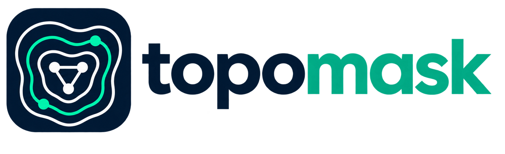

<p align="center">
  <picture>
    <source media="(prefers-color-scheme: dark)" srcset="assets/logo-dark.png">
    
  </picture>
</p>

# topomask

**Reversible, topology-preserving anonymizer for logs and configs before you paste them into an AI.**

topomask replaces hostnames, IP addresses, users, secrets and personal data with consistent fake values, keeps the mapping on your machine, and puts the real values back when you paste the AI's answer. Everything runs locally: the web version is a single HTML file that cannot open network connections.

It is meant for system administrators, network and storage engineers, and anyone who needs help from a language model with real logs, configurations or technical emails without disclosing the infrastructure behind them.

## Why another anonymizer

Generic PII tools replace values with random tokens, so the model can no longer reason about the network. topomask keeps the structure:

- **Topology preserved.** Addresses in the same real /24 land in the same fake /24 and keep their last octet. The same domain always becomes the same fake zone. Hostnames with dashes are replaced piece by piece. MAC addresses keep the vendor OUI. The model can still reason about subnets, routing and vendors.
- **Sysadmin coverage.** `DOMAIN\user`, LDAP DNs (`CN`/`OU`/`DC`), SIDs with the RID kept, GUIDs, UNC paths, shell prompts like `[user@host dir]#`, `/etc/hosts` lines, syslog headers, `ssh`/`ping`/`dig` targets, Cisco secrets (`$9$`, `key 7`), SNMP communities, pre-shared keys, JWTs and cloud API keys.
- **Storage and cloud identifiers.** Fibre Channel WWNs/WWPNs, SCSI `naa.`/`eui.` identifiers and multipath WWIDs keep their vendor part; iSCSI IQNs follow the domain mapping; AWS ARNs and account IDs; hardware serial numbers.
- **Italian personal data, checksum-validated.** Tax code (codice fiscale), VAT number (partita IVA) and IBAN (mod-97), plus phone numbers and payment cards (Luhn, only next to a keyword).
- **Zero network.** A single HTML file with a `default-src 'none'` Content Security Policy that anyone can inspect. The desktop app makes one request a day to GitHub only if you opt in to update checks.
- **Windows desktop app.** A notification-area icon and two global hotkeys that anonymize or restore the clipboard, so it works with any chat client.

## Example

Input, with the term list `Contoso=COMPANY_A`:

```text
Nov 13 10:02:11 web01 sshd[2211]: Failed password for invalid user jdoe from 192.0.2.10 port 52044 ssh2
Nov 13 10:02:15 web01 sshd[2213]: Accepted publickey for jsmith from 192.0.2.77 port 40112 ssh2
[root@contoso-db-02 ~]# ping -c 3 nas01.corp.example.net
PING nas01.corp.example.net (198.51.100.25) 56(84) bytes of data.
mount \\fileserver01\backup as CORP\svc-backup
ldap bind CN=Jane Doe,OU=Operations,DC=corp,DC=example,DC=net
db_password=Sup3rS3cret!
```

Output:

```text
Nov 13 10:02:11 srv3 sshd[2211]: Failed password for invalid user user2 from 198.18.0.10 port 52044 ssh2
Nov 13 10:02:15 srv3 sshd[2213]: Accepted publickey for user3 from 198.18.0.77 port 40112 ssh2
[root@COMPANY_A-db-02 ~]# ping -c 3 srv1.srv2.dom1.invalid
PING srv1.srv2.dom1.invalid (198.18.1.25) 56(84) bytes of data.
mount \\srv4\backup as DOM1\user1
ldap bind CN=cn1,OU=ou1,DC=srv2,DC=dom1,DC=invalid
db_password=<SECRET>
```

After the AI answers, **Restore** turns every fake value in its reply back into the real one. Secrets are removed for good and are never restored.

## Usage

### In a browser (any OS)

1. Download `topomask.html` from the [latest release](https://github.com/felicerosella/topomask/releases/latest) (for v0.1.0, from [`src/` at the tag](https://github.com/felicerosella/topomask/blob/v0.1.0/src/topomask.html) with **Download raw file**).
2. Open it with a double click. Data (mapping, terms, settings) is kept in the browser's local storage for that file.
3. Paste text, press **Anonymize and copy** (<kbd>Ctrl</kbd>+<kbd>Enter</kbd>), paste the result into the AI. Paste the answer back and press **Restore and copy**.

### Windows desktop app

**Installer (recommended).** Download `topomask-vX.Y.Z-win-x64-setup.exe` from the [releases](https://github.com/felicerosella/topomask/releases), [verify it](#verifying-a-release) and run it. It installs for the current user only, without administrator rights, in `%LOCALAPPDATA%\Programs\topomask`, adds a Start menu entry and can optionally start topomask in the notification area when you sign in. Uninstall it from **Settings → Apps**; your data in `%APPDATA%\topomask\` is kept.

**Portable zip.** `topomask-vX.Y.Z-win-x64.zip` runs without installation. Before extracting, right-click the zip → **Properties** → check **Unblock** → **OK**: Windows marks files downloaded from the internet, and the .NET components used by WebView2 refuse to load from marked files. If you already extracted it, run `Get-ChildItem -Recurse | Unblock-File` in PowerShell from the extracted folder.

Command-line options: `--tray` starts hidden in the notification area, `--debug` logs the full details of a startup failure.

Copy text anywhere and press <kbd>Ctrl</kbd>+<kbd>Alt</kbd>+<kbd>A</kbd> to replace the clipboard with its anonymized version, or <kbd>Ctrl</kbd>+<kbd>Alt</kbd>+<kbd>R</kbd> to restore it.

The shortcuts can be changed in **Settings → Keyboard shortcuts**: click a shortcut and press the new combination (Ctrl, Alt or Win plus a letter, a digit or F1–F24). Changes apply immediately; if another application already uses the combination, the previous shortcut stays active. Backspace turns a shortcut off. On layouts with AltGr, avoid Ctrl+Alt combinations that type characters (Windows treats AltGr as Ctrl+Alt).

### Update check

On first start the desktop app asks whether to check GitHub once a day for a new version. If you agree, it requests the metadata of the latest release from `api.github.com` (GitHub sees your IP address and the `topomask/<version>` user agent; no text, mapping or identifier is sent). When a newer version exists, a notification and a tray menu entry open its release page; nothing is downloaded or installed automatically. You can change the choice in **Settings**. The browser version never connects anywhere: watch the repository releases on GitHub instead.

Data is stored in `%APPDATA%\topomask\`. Restored text is copied with the flags that keep it out of the Windows clipboard history (<kbd>Win</kbd>+<kbd>V</kbd>) and cloud clipboard sync.

Releases are not code-signed yet, so Windows SmartScreen may warn when you run the installer or the app ("Windows protected your PC"). Verify the checksum and the build attestation first, then choose **More info → Run anyway**.

Requirements: Windows 10 or 11 (x64) with the Microsoft Edge WebView2 Runtime, which is preinstalled on current Windows versions.

## Configuration

| Section | Purpose |
|---|---|
| **Terms** | One term per line, `real` or `real=fake`. Always replaced, case-insensitively and also inside longer words (for example a customer name inside a hostname). Without an explicit fake, `TERM_N` is used. |
| **Keep as is** | Domains and names never replaced. A domain also covers its subdomains. Common public domains are listed by default. |
| **Settings** | Turn detection categories on or off, choose the interface language (English or Italian), reset the mapping. |

## Placeholder formats

| Data | Placeholder |
|---|---|
| IPv4 | `198.18.0.0/15` (RFC 2544), same /24 for the same real /24, real last octet |
| IPv6 | `2001:db8:N::n` (RFC 3849), same `N` for the same real /64 |
| Domain | `domN.invalid` (RFC 2606) |
| Host label | `srvN`; dashed names piece by piece as `partN` |
| User | `userN`; NetBIOS domain `DOMN`; LDAP `cnN`, `ouN` |
| MAC | real OUI + counter, original separator |
| WWN / NAA / EUI / WWID | real vendor part + counter, same length and format |
| iSCSI IQN | `iqn.<date>.<fake reversed domain>:iscsiN` |
| AWS account / serial number | `000000000001` / `SERIAL_N` |
| GUID / SID | `00000000-0000-0000-0000-…` / `S-1-5-21-1000-1000-…` with the real RID |
| Personal data | `IBAN_N`, `TAXID_N`, `VAT_N`, `PHONE_N` |
| Terms | your fake or `TERM_N`; other spellings `~1`, `~2` |
| Removed, not restorable | `<SECRET>`, `<CARD>`, `<HASH>`, `<FINGERPRINT>`, `[banner removed]` |

## Verifying a release

Each release ships `SHA256SUMS.txt`, a CycloneDX SBOM and a GitHub build provenance attestation.

```sh
sha256sum --check --ignore-missing SHA256SUMS.txt
gh attestation verify topomask-vX.Y.Z-win-x64.zip --repo felicerosella/topomask
```

On Windows PowerShell: `Get-FileHash topomask-vX.Y.Z-win-x64.zip -Algorithm SHA256` and compare with `SHA256SUMS.txt`.

## Building from source

The desktop app is built on Windows with Python 3.10 or later:

```bat
build.bat
```

The script installs the hash-locked dependencies from `requirements-build.txt` into `.venv-build`, runs PyInstaller and writes `dist\topomask\` together with `THIRD_PARTY_LICENSES.txt`.

To build the installer as well, run `powershell -File scripts\build_installer.ps1`. It uses `ISCC.exe` from [Inno Setup](https://jrsoftware.org/isinfo.php) if it is on the `PATH`, otherwise it downloads a pinned, checksum-verified Inno Setup release, and writes `out\topomask-vX.Y.Z-win-x64-setup.exe`.

## Known limitations

- `map.json` is stored in clear text in `%APPDATA%\topomask\` (or in the browser's local storage). Protect it like the original data. DPAPI encryption is planned for 1.0.
- The original text you copied stays in the clipboard history; clear it if needed.
- Detection is heuristic. Personal names in free text are not detected; always review the output before sharing it.
- A real value shaped like a fake that was already assigned (for example a host really called `srv7` seen for the first time after `srv7` was handed out) is treated as a fake and restored incorrectly.
- Fakes you choose for terms must be distinctive: they are restored by plain substring replacement.
- Short or generic hostname pieces (`db`, `node`, `prod`, numbers) are kept to preserve readability, so names made only of such pieces are not replaced.

## Contributing

See [CONTRIBUTING.md](CONTRIBUTING.md). Security issues: see [SECURITY.md](SECURITY.md).

## License

[Apache-2.0](LICENSE). The Windows build bundles third-party components under their own licenses, listed in `THIRD_PARTY_LICENSES.txt`.
